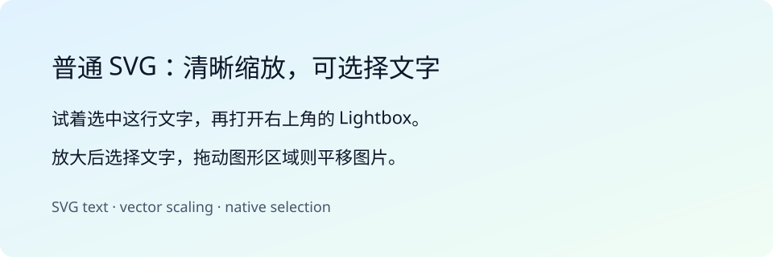

# SVG 图片

普通 SVG 图片与 Mermaid 图表均可在 WebUI 中以原生 SVG 查看。正文中的文字可以
直接选中；通过右上角按钮进入 Lightbox 后，放大仍保持矢量清晰度，可以选择
`text`、`tspan` 及 `foreignObject` 中的文字。SVG 不显示底部图片信息。

SVG 图片沿用正文图片的延迟加载。使用 HTML `picture` 或 `srcset` 时，以浏览器实际
选中的 SVG 资源为准。Lightbox 中可以缩放、旋转与拖动；鼠标从文字开始拖动时
选择文字，从图形或空白区域开始拖动时平移图片。

## 兼容边界

- 本地 `.svg` 图片和 SVG data URL 可直接使用；远程 SVG 需要图片服务器允许 CORS
  读取。反向代理额外设置 CSP 时，`connect-src` 也需要允许图片来源。
- SVG 内嵌的位图仍受原图分辨率限制；已经转换为路径的文字无法作为文本选择。
- SVG 在独立样式作用域中显示，并移除脚本、事件处理器、动画与链接导航；含有
  `:host`、`::slotted` 或 `@import` 样式的资源使用原图片方式显示。
- 无法读取或解析 SVG 源码时，继续显示已加载的原图片，此时内部文字无法选择。
- HTML 导出保留普通图片的原始引用方式；此处的文字选择与 Lightbox 增强适用于 WebUI。
