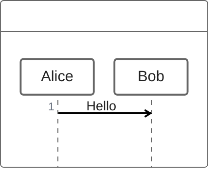
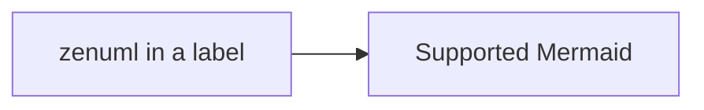

# 已移除图表渲染器回归

```vega-lite
{"mark":"bar","description":"removed-renderer-search-token"}
```

```vegalite
{ invalid JSON
```



```zenuml
Alice->Bob: Hello
```

```vega-lite
line 01
line 02
line 03
line 04
line 05
line 06
line 07
line 08
line 09
line 10
line 11
line 12
line 13
line 14
line 15
line 16
line 17
line 18
line 19
line 20
line 21
line 22
line 23
line 24
line 25
line 26
line 27
line 28
line 29
line 30
```



数学公式 $E = mc^2$。

| Name | Count |
| --- | --- |
| Beta | 2 |
| Alpha | 1 |
