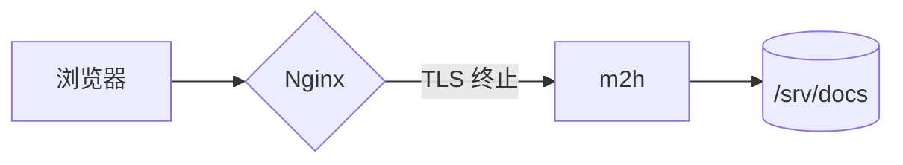

# 安全头富内容回归文档

验证 Mermaid、公式、表格与图片在严格 CSP 下正常展示。


## Mermaid 流程图



## 数学公式

行内公式 $E = mc^2$ 与行间公式：

$$\int_0^1 x^2 \, dx = \frac{1}{3}$$

金额写法（如 $5 与 $10）不受单美元分隔影响，保持普通文本。

## 可排序表格

| 组件 | 默认端口 |
| --- | --- |
| m2h | 8793 |
| Nginx | 443 |
| Tinyauth | 3000 |

## 图片

本地 SVG 图片：


外部图片：


## 代码块

```go
func healthz(w http.ResponseWriter, r *http.Request) {
	fmt.Fprintln(w, "ok")
}
```
